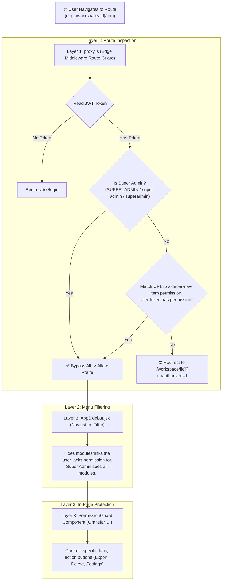

# 🛡️ Role & Permission-Based Access Control (RBAC) Implementation Plan

> **Objective:** Secure the Devlomatix Workspace navigation and route access using a defense-in-depth architecture.
> - **Super Admin Bypass:** If the user has a Super Admin role (`SUPER_ADMIN`, `super-admin`, `superadmin`, `super_admin`, or `Super Admin`), grant unrestricted access to all 22+ workspace modules.
> - **Non-Admin Access:** Restricted according to module permissions mapped from `src/app/workspace/_lib/sidebar-nav-item.js`.
> - **Multi-Layer Defense:** Enforce hard route boundaries in `src/proxy.js`, dynamic UI menu trimming in `AppSidebar.jsx`, and granular in-page component authorization via `<PermissionGuard>`.

---

## 🏗️ 1. Architecture: The 3-Layer Security Model

---

## 📋 2. Step-by-Step Execution Plan

### Step 1: Create Edge-Compatible RBAC & Navigation Helper
**File:** `src/lib/rbac-utils.js`

- **Purpose:** Pure JavaScript utility compatible with both Edge runtime (`proxy.js`) and Client/Server components.
- **Key Functions:**
  1. `isSuperAdmin(token)`: Robust checker supporting all casing and hyphenation variants (`SUPER_ADMIN`, `super-admin`, `superadmin`, `super_admin`, `Super Admin`).
  2. `extractUserPermissions(token)`: Extracts permission strings from `token.roles` (which are already enriched in NextAuth JWT).
  3. `getRequiredPermissionForPath(pathname, workspaceId)`: Resolves an incoming request path against the navigation items defined in `sidebar-nav-item.js`.

---

### Step 2: Implement Route Guard in `proxy.js`
**File:** `src/proxy.js`

- Intercepts requests matching `/workspace/:workspaceId/:module`.
- Immediately allows requests if user is a Super Admin.
- For non-super-admins:
  - Resolves required permission for the current path.
  - If required permission is found and missing from the user's active permissions, redirects them to `/workspace/:workspaceId?unauthorized=1&module=...`.

---

### Step 3: Implement Dynamic Menu Trimming in `AppSidebar.jsx`
**File:** `src/app/workspace/_components/AppSidebar.jsx`

- Leverages `useAccess()` from `AccessProvider.js`.
- Filters `navigation` array so unauthorized parent groups and children are not rendered.
- **Benefit:** Clean UI without clutter or broken links for sales reps or standard staff members.

---

### Step 4: Create Reusable `<PermissionGuard>` Component
**File:** `src/components/auth/PermissionGuard.jsx`

- Reusable client component to wrap buttons, forms, and tabs.
- Supports both `permission` (e.g. `"navbar:DevX(CRM):Parent"`) and `role` attributes.
- Configurable fallback (e.g., render nothing, or render a custom "Access Restricted" alert card).

---

### Step 5: Verification & Testing
1. **Super Admin Testing:** Login with a super-admin account and verify access to all 22+ modules.
2. **Restricted User Testing:** Assign a user role with only CRM permissions; verify:
   - eCommerce, HireFlow, and FleetX are hidden in `AppSidebar`.
   - Direct address bar navigation to `/workspace/[id]/ecommerce` redirects gracefully.
   - Access to `/workspace/[id]/crm` succeeds.
